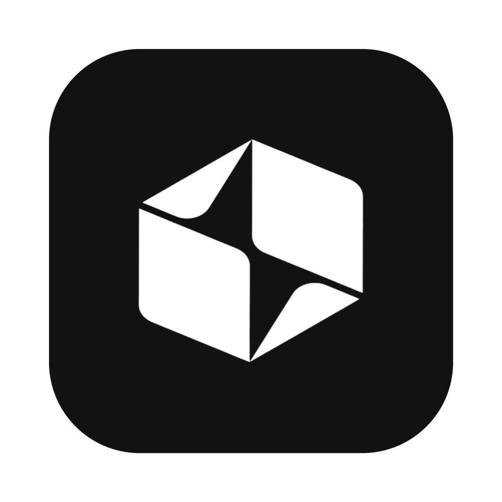

# Overhead



A small macOS menu bar app for holding files while you work. Drop screenshots, documents, images, links or text into it, then drag them out again wherever you need them.

## What it does

- Click the logo in the menu bar to open the box. Dragging a file onto the logo opens it too.
- Drop in files, screenshots (including the floating screenshot thumbnail), images from a browser, links and text. Press ⌘V with the box open to paste whatever is on the clipboard.
- Drag any item out into Finder, Mail, Messages, Slack, a browser upload field and so on. With more than one item, the stack icon in the footer drags everything at once.
- **AirDrop** or **Share…** zips everything in the box into `Overhead.zip` and sends it. You can also save the zip to Downloads from the ⋯ menu.
- Double-click an item to open it. Right-click for Open, Show in Finder, Copy and Remove.
- Items stay in the box until you remove them, including across restarts.

Overhead keeps its own copy of each item in `~/Library/Application Support/Overhead/`. On APFS drives these copies are clones, so they take no extra disk space, and deleting the original doesn't remove it from the box.

## Requirements

- macOS 13 Ventura or later
- Swift 5.9 or later (Xcode or the Command Line Tools: `xcode-select --install`)

## Build and run

```sh
git clone https://github.com/AntigoneXIII/Overhead.git
cd Overhead
./build.sh --install
```

This builds `Overhead.app`, copies it to `~/Applications` and launches it. Run `./build.sh` without `--install` to build into `./build` only.

The app is ad-hoc signed, which is fine for running a copy you built yourself. To distribute a prebuilt app to other people it would need signing with a Developer ID and notarising.

## Project layout

| Path | Purpose |
| --- | --- |
| `Sources/Overhead/StatusController.swift` | Menu bar item, drop-down panel, AirDrop and share actions |
| `Sources/Overhead/PanelView.swift` | The panel UI (SwiftUI) and the logo drawing |
| `Sources/Overhead/BayStore.swift` | Stored items and importing drops and pastes |
| `Sources/Overhead/DragSource.swift` | Dragging items out to other apps |
| `Sources/Overhead/OverheadZip.swift` | Building `Overhead.zip` |
| `Sources/Overhead/LogoPath.swift` | Logo outline, generated by `tools/trace_logo.py` |

To regenerate the logo outline after changing `Resources/brand/logo-source.png`:

```sh
python3 tools/trace_logo.py Resources/brand/logo-source.png Sources/Overhead/LogoPath.swift
```

## License

MIT. See [LICENSE](LICENSE).
